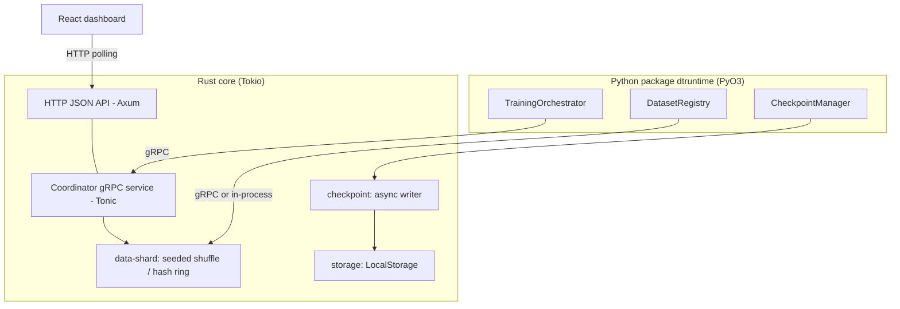
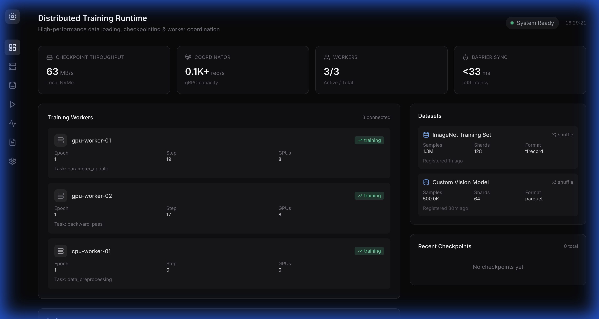
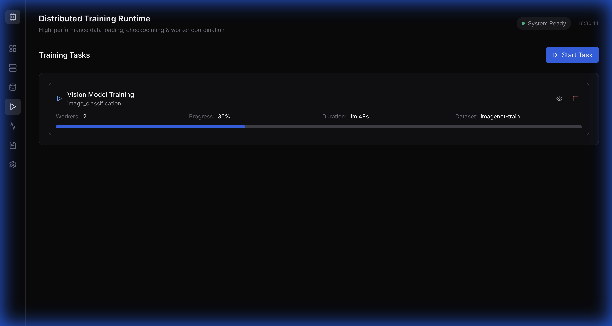

# Strata

[](https://github.com/syrilj/Strata/actions/workflows/ci.yml)
[](LICENSE)

Strata is a coordination runtime for distributed ML training jobs. A Rust coordinator tracks workers, hands out dataset shards, runs barriers, and records checkpoints; training code talks to it through a Python package built with PyO3. A React dashboard shows coordinator state.

It is a working prototype that has been tested on a single machine. It has not been run on a multi-node cluster or at large worker counts. See [Current limits](#current-limits).

## What it does

- **Worker membership**: workers register over gRPC and send heartbeats. A background reaper removes workers that miss the heartbeat timeout (30 s by default), rebalances their shards, and re-evaluates any barrier they were part of.
- **Dataset sharding**: a dataset is described by sample count and shard size. With `shuffle=true` (the default) shards are permuted with a seeded per-epoch shuffle and dealt round-robin by worker rank, so every worker can reproduce the same assignment. With `shuffle=false` shards are placed on a consistent-hash ring (150 virtual nodes per worker), so adding or removing a worker only moves the shards on the affected ring segments.
- **Barriers**: named barriers that release once every active worker has arrived.
- **Checkpoints**: `save` queues a write for a background Tokio task and returns. The local backend writes a temp file, fsyncs it, and renames it into place; LZ4 compression is optional. Workers report checkpoints to the coordinator, and a restarted worker can ask it for the latest one to resume from.
- **HTTP API and dashboard**: a JSON API (`/api/health`, `/api/workers`, `/api/datasets`, `/api/checkpoints`, `/api/metrics`, …) and a React dashboard on top of it.
- **Request guards**: per-client token-bucket rate limiting, input validation, and per-RPC request metrics.

## Architecture



| Crate | Role |
|---|---|
| `crates/coordinator` | gRPC service (`proto/coordinator.proto`), HTTP API, middleware, `coordinator` binary |
| `crates/data-shard` | consistent-hash ring, epoch shuffling, `ShardManager` |
| `crates/checkpoint` | checkpoint manager and background writer |
| `crates/storage` | `StorageBackend` trait, `LocalStorage`, `S3Storage` (feature-gated and unused; see limits) |
| `crates/runtime-core` | configuration, shared types, errors |
| `crates/python-bindings` | PyO3 extension `dtruntime._core` |

More detail: [docs/ARCHITECTURE.md](docs/ARCHITECTURE.md) and [docs/API.md](docs/API.md).

## Current limits

- **Single coordinator.** Not replicated or highly available. Worker, dataset, and barrier state lives in memory and is lost on restart (checkpoint files on disk are rescanned at startup).
- **No authentication or TLS** on the gRPC or HTTP endpoints. Run it only on a trusted network.
- **Local storage only in practice.** `S3Storage` exists in the `storage` crate behind the non-default `s3` feature, but the coordinator binary and the Python API do not use it. With `STORAGE_BACKEND=s3` the coordinator logs a warning and writes to local disk. `S3Storage` has unit tests for key/config handling only and has never been run against S3.
- **Tested scale is small.** The largest test runs 8 simulated workers against one coordinator in one process. The "1000 workers" benchmark cases register 1000 IDs in an in-process data structure; they are not 1000 real workers.
- **Checkpoint data is copied** once from Python `bytes` into Rust (not zero-copy).
- The Docker Compose and Kubernetes files have not been verified in the latest cleanup.

## Quick start

Verified on Ubuntu 24.04 with Rust 1.97 and Python 3.13. `pyproject.toml` declares Python 3.10+.

Prerequisites: Rust (stable, via `rustup`), `protoc` (`sudo apt-get install protobuf-compiler` on Debian/Ubuntu), Python 3.10+.

```bash
git clone https://github.com/syrilj/Strata.git
cd Strata
```

Build and start the coordinator (gRPC on 50051, HTTP API on 51051):

```bash
cargo run --release -p coordinator --bin coordinator -- 127.0.0.1:50051
```

In a second terminal, check it is up, install the Python package, and run the example worker:

```bash
curl http://127.0.0.1:51051/api/health
```

```bash
python3 -m venv .venv && . .venv/bin/activate
```

```bash
pip install -e ".[dev]"
```

```bash
python examples/quickstart.py
```

Expected output (IDs, paths and the shard range will differ):

```
registered worker-0
epoch 0, first assigned shard: samples [30000, 40000) (dataset has 10 shards)
step 10: checkpoint ckpt-10-… -> /tmp/strata-ckpt-…/ckpt-10-….ckpt
step 20: checkpoint ckpt-20-… -> /tmp/strata-ckpt-…/ckpt-20-….ckpt
step 30: checkpoint ckpt-30-… -> /tmp/strata-ckpt-…/ckpt-30-….ckpt
coordinator's latest checkpoint: step 30, payload b'model-state-at-step-30'
barrier released: True
deregistered
```

The core of [`examples/quickstart.py`](examples/quickstart.py):

```python
from dtruntime import CheckpointManager, TrainingOrchestrator

orch = TrainingOrchestrator("http://127.0.0.1:50051", worker_id="worker-0", world_size=1, rank=0)
orch.register_worker(hostname="127.0.0.1", port=50060)

orch.register_dataset(dataset_id="train", path="/tmp/strata-quickstart-data",
                      total_samples=100_000, shard_size=10_000, shuffle=True, seed=42)
shard = orch.get_shard("train", epoch=0)

ckpts = CheckpointManager("/tmp/my-checkpoints")
ckpt_id = ckpts.save(b"model state", step=10, epoch=0)  # queues a background write
ckpts.wait_pending()                                    # block until it is on disk
info = ckpts.get_by_step(10)
orch.notify_checkpoint(checkpoint_id=ckpt_id, step=10, epoch=0,
                       storage_path=info.path, size_bytes=len(b"model state"))

orch.barrier("done", step=10)
orch.deregister()
```

In async code, `await ckpts.save_async(data, step=...)` resolves once the write is on disk.

To run the coordinator, local workers and the dashboard together, see `./run-local.sh` and [docs/WALKTHROUGH.md](docs/WALKTHROUGH.md).

## Performance

Measured on one 4-vCPU cloud VM with local ext4 storage. The full tables, the command, and what each benchmark times are in **[BENCHMARKS.md](BENCHMARKS.md)**. There are no multi-node, GPU, or S3 measurements.

| Measurement | Result |
|---|---|
| Durable local checkpoint write (temp file + fsync + rename), 1 MB / 10 MB / 100 MB | 2.15 ms / 13.1 ms / 137 ms (443 / 726 / 698 MiB/s) |
| 8 concurrent 1 MB durable writes | 9.19 ms total (830 MiB/s) |
| Time the caller is blocked by Rust `save_async` (queue only), 10 MB | 11.0 µs |
| gRPC `RegisterWorker`, including opening a new connection | 6.00 ms |
| gRPC barrier with 8 participants, including connections | 37.2 ms |
| Hash-ring key lookup (10 nodes) | 49.5 ns |
| Build in-process shard assignment for 1000 worker IDs × 10,000 shards | 77.8 ms |

## Tests

```bash
cargo fmt --all -- --check
cargo clippy --all-targets --all-features -- -D warnings
cargo test --all
pytest tests/python -v      # in the venv above; starts the coordinator binary itself
```

On the machine in BENCHMARKS.md: `cargo test --all` passes 85 tests (1 doc test ignored), `pytest` passes 19 tests, and the dashboard's `npm test` passes 20 tests. The Rust tests include gRPC integration tests and an end-to-end simulation with up to 8 workers covering shard distribution, barriers, checkpoint recovery, and worker failure.

CI (`.github/workflows/ci.yml`) runs formatting, clippy, Rust tests on Linux and macOS, the Python tests, and the dashboard type-check, lint, tests and build.

## Dashboard

The dashboard (`dashboard/`) polls the coordinator's HTTP API. The screenshots below show **synthetic demo data** (`DEMO_MODE=true`), not measurements.

| Overview | Tasks |
|---|---|
|  |  |

More screenshots and how to run it: [docs/WALKTHROUGH.md](docs/WALKTHROUGH.md).

## Documentation

- [docs/ARCHITECTURE.md](docs/ARCHITECTURE.md) – design, request flows, failure handling
- [docs/API.md](docs/API.md) – Python, HTTP, gRPC and Rust APIs
- [docs/DEPLOYMENT.md](docs/DEPLOYMENT.md) – building, configuration, Docker and Kubernetes (unverified), S3 status
- [BENCHMARKS.md](BENCHMARKS.md) – measured results
- [CONTRIBUTING.md](CONTRIBUTING.md), [SECURITY.md](SECURITY.md), [CHANGELOG.md](CHANGELOG.md)

## How this was built

I designed the architecture and wrote the specifications for the components (coordinator, sharding, checkpointing, Python API). Coding agents, GitHub Copilot's coding agent and Claude Code, wrote much of the implementation, which I reviewed.

## License

MIT. See [LICENSE](LICENSE).
