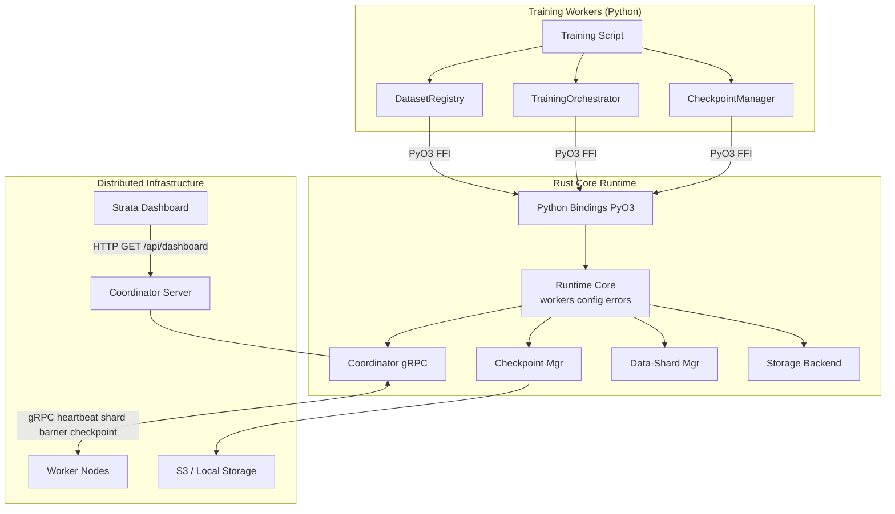
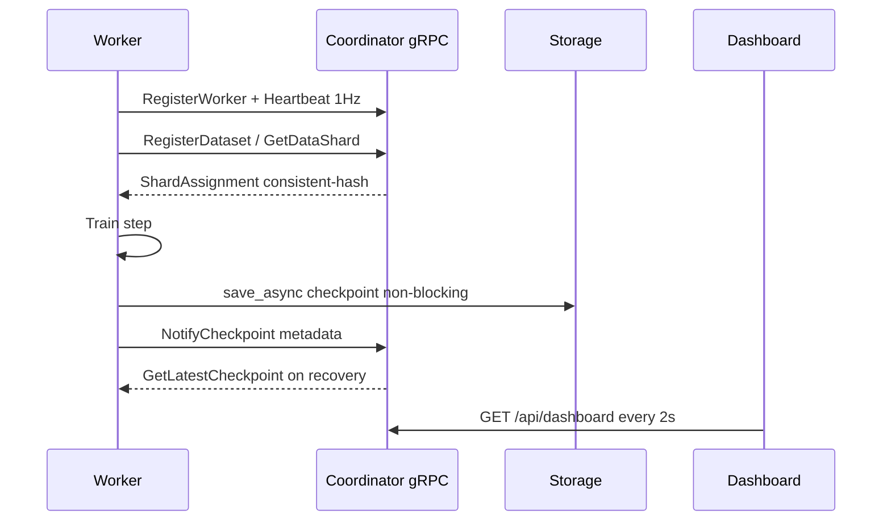
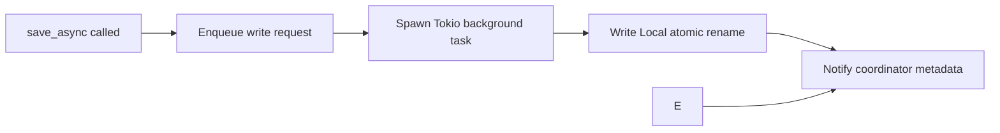

# Architecture

> Rendered diagrams (Mermaid) first — ASCII fallback preserved below for
> terminals.

## System Overview (Mermaid)



## Request Flows





## System Overview (ASCII fallback)

Strata coordinates data-shard assignment, checkpoint persistence, and barrier synchronization for distributed ML training workers. It has been tested on a single machine only (see [BENCHMARKS.md](../BENCHMARKS.md)); multi-node scale has not been measured.

### Design Principles

1. **Async I/O**: Rust core on Tokio; checkpoint writes run on a background task
2. **Failure handling**: dead workers are reaped after a heartbeat timeout and their shards reassigned; workers can query the latest checkpoint to resume
3. **Simplicity**: a small Python API (PyO3) over the Rust core

## High-Level Architecture

```
┌───────────────────────────────────────────────────────────────┐
│                     Training Workers (Python)                  │
│  ┌──────────────────────────────────────────────────────────┐ │
│  │  Training Script                                          │ │
│  │  ┌────────────┐ ┌──────────────┐ ┌──────────────────┐   │ │
│  │  │DatasetReg  │ │CheckpointMgr │ │TrainingOrch      │   │ │
│  │  └────────────┘ └──────────────┘ └──────────────────┘   │ │
│  └──────────────────────────────────────────────────────────┘ │
└───────────────────────────────────────────────────────────────┘
                            │ PyO3 FFI
┌───────────────────────────────────────────────────────────────┐
│                      Rust Core Runtime                         │
│  ┌──────────────────────────────────────────────────────────┐ │
│  │  Python Bindings (PyO3)                                   │ │
│  └──────────────────────────────────────────────────────────┘ │
│  ┌──────────────────────────────────────────────────────────┐ │
│  │  Runtime Core                                             │ │
│  │  • Worker Management                                      │ │
│  │  • Configuration                                          │ │
│  │  • Error Handling                                         │ │
│  └──────────────────────────────────────────────────────────┘ │
│  ┌────────────┐ ┌──────────┐ ┌────────────┐ ┌─────────────┐ │
│  │Coordinator │ │Checkpoint│ │Data Shard  │ │Storage      │ │
│  │(gRPC)      │ │Manager   │ │Manager     │ │Backend      │ │
│  └────────────┘ └──────────┘ └────────────┘ └─────────────┘ │
└───────────────────────────────────────────────────────────────┘
                            │ Network I/O
┌───────────────────────────────────────────────────────────────┐
│                   Distributed Infrastructure                   │
│  ┌──────────────┐  ┌──────────────┐  ┌───────────────────┐  │
│  │ Worker Nodes │  │ Coordinator  │  │ S3/Storage        │  │
│  │              │  │ Server       │  │ Backend           │  │
│  └──────────────┘  └──────────────┘  └───────────────────┘  │
└───────────────────────────────────────────────────────────────┘
```

## Component Details

### 1. Coordinator (gRPC Server)

**Purpose**: Central coordination service for worker management and synchronization

**Key Responsibilities**:
- Worker registration and heartbeat monitoring
- Dataset metadata management
- Shard assignment coordination
- Barrier synchronization for distributed training
- Checkpoint metadata tracking

**Implementation**:
- Built with Tonic (gRPC for Rust)
- Uses DashMap for concurrent state management
- Async request handling with Tokio

**Protocol Buffers** (proto/coordinator.proto):
```protobuf
service CoordinatorService {
    rpc RegisterWorker(WorkerInfo) returns (WorkerRegistration);
    rpc Heartbeat(HeartbeatRequest) returns (HeartbeatResponse);
    rpc RegisterDataset(DatasetInfo) returns (DatasetRegistration);
    rpc GetDataShard(ShardRequest) returns (ShardAssignment);
    rpc WaitBarrier(BarrierRequest) returns (BarrierResponse);
    rpc NotifyCheckpoint(CheckpointInfo) returns (CheckpointResponse);
    rpc GetLatestCheckpoint(RecoveryRequest) returns (RecoveryInfo);
}
```

**Performance**: see [BENCHMARKS.md](../BENCHMARKS.md) for single-machine measurements of registration, heartbeat, shard lookup and barrier RPCs.

### 2. Data Shard Manager

**Purpose**: Distribute dataset shards evenly across workers using consistent hashing

**Key Features**:
- **Consistent Hashing**: Minimizes data movement when workers join/leave
- **Epoch Management**: Tracks shard assignments per training epoch
- **Load Balancing**: Even distribution across workers

**Algorithm**:
```rust
// Consistent hash ring with virtual nodes
Ring: HashMap<u64, WorkerID>
VirtualNodesPerWorker: 150

fn get_node_for_shard(shard_id: usize) -> WorkerID {
    hash = hash(dataset_id + shard_id)
    ring.range(hash..).next().or(ring.first())
}
```

**Important**: the hash ring is used only for datasets registered with `shuffle=false`. With `shuffle=true` (the default) shards are permuted with a seeded per-epoch shuffle (ChaCha8, seed derived from base seed + dataset + epoch) and dealt round-robin by worker rank, so adding or removing a worker reassigns most shards.

**Trade-offs**:
- Virtual nodes (150 per worker) increase memory but improve distribution uniformity
- Unit tests check that each of 3 workers gets within ±50% of an even share, and that removing a node only moves keys that were on that node. Tighter balance bounds have not been measured.

**Performance**:
- Ring lookup is a binary search over `workers * virtual_nodes` entries
- Measured assignment times are in [BENCHMARKS.md](../BENCHMARKS.md)

### 3. Checkpoint Manager

**Purpose**: Async checkpoint persistence with background I/O

**Key Features**:
- `save_async` enqueues the write and returns; a background Tokio task performs it
- Local storage writes a temp file, fsyncs it, then renames it into place
- Optional LZ4 compression
- Storage is behind a `StorageBackend` trait (see S3 note below)

**Write Path**:
```
User calls save_async()
  ↓
Enqueue write request on a channel
  ↓
Return checkpoint id to caller
  ↓
Background writer task: (optional LZ4) → header + payload → storage.write
```

**Storage Abstraction**:
```rust
#[async_trait]
pub trait StorageBackend: Send + Sync {
    async fn write(&self, path: &str, data: Bytes) -> Result<()>;
    async fn read(&self, path: &str) -> Result<Bytes>;
    async fn list(&self, prefix: &str) -> Result<Vec<String>>;
    async fn delete(&self, path: &str) -> Result<()>;
}
```

**Implementations**:
- **LocalStorage**: file system storage with atomic (temp file + fsync + rename) writes
- **S3Storage**: implemented in the `storage` crate behind the non-default `s3` cargo feature (multipart upload, retry with backoff). It is **not wired into the coordinator binary or the Python API**: setting `STORAGE_BACKEND=s3` makes the coordinator log a warning and fall back to local storage. It has unit tests for key/config handling only and has not been run against S3.

**Performance**: see [BENCHMARKS.md](../BENCHMARKS.md) (local storage only).

### 4. Runtime Core

**Purpose**: High-level orchestration and worker lifecycle management

**Components**:
- **Config**: TOML-based configuration management
- **Worker**: Worker state and communication handling
- **Types**: Shared type definitions
- **Error**: Unified error handling with thiserror

**Worker Lifecycle**:
```
Initialize → Register → Heartbeat Loop → Train → Checkpoint → Finalize
                ↓                                    ↓
          Assign Shards                        Notify Coord
```

### 5. Python Bindings (PyO3)

**Purpose**: Expose Rust functionality with Pythonic API

**Key Classes**:
- `DatasetRegistry`: Dataset registration and shard retrieval
- `CheckpointManager`: Async checkpoint save/load
- `TrainingOrchestrator`: High-level training coordination

**FFI Strategy**:
- Checkpoint bytes are copied once from the Python `bytes` object into a Rust `Bytes` buffer (not zero-copy)
- pyo3-async-runtimes for async/await integration
- Blocking calls release the GIL while waiting on the Tokio runtime

The bindings live in `crates/python-bindings/src/` (`checkpoint.rs`, `dataset.rs`, `orchestrator.rs`).

## Data Flow

### Training Iteration

```
1. Worker calls get_batch()
     ↓
2. DatasetRegistry.get_shard()
     ↓ gRPC
3. Coordinator assigns shards (seeded shuffle + round-robin, or consistent hash when shuffle=false)
     ↓
4. Worker loads data from assigned files
     ↓
5. Train step
     ↓
6. (Every N steps) CheckpointManager.save_async()
     ↓ Spawn task
7. Background Tokio task writes to storage
     ↓ gRPC (notify)
8. Coordinator records checkpoint metadata
```

### Fault Recovery

```
1. Worker crashes
     ↓
2. Coordinator detects missed heartbeats
     ↓
3. Mark worker as failed
     ↓
4. Redistribute shards to remaining workers
     ↓
5. New/restarted worker calls recovery()
     ↓ gRPC
6. Coordinator returns latest checkpoint info
     ↓
7. Worker loads checkpoint from storage
     ↓
8. Resume training from checkpoint step
```

## Design Decisions

### Why Rust?

**Advantages**:
1. **Performance**: Zero-cost abstractions, no GC pauses
2. **Safety**: Prevents data races at compile time
3. **Async I/O**: Tokio provides excellent async runtime
4. **FFI**: PyO3 makes Python integration straightforward

**Trade-offs**:
- Steeper learning curve vs Python-only solution
- Longer compile times
- Worth it for performance-critical infrastructure

### Why gRPC?

**Advantages**:
1. **HTTP/2**: Multiplexing, header compression
2. **Strong typing**: Protobuf schema enforcement
3. **Streaming**: Efficient for heartbeats and barriers
4. **Cross-language**: Easy to add workers in other languages

**Alternatives Considered**:
- REST: Too much overhead for high-frequency RPCs
- Raw TCP: No schema, more error-prone
- Redis: Extra dependency, not designed for RPC

### Why Consistent Hashing?

**Advantages**:
1. **Minimal Redistribution**: Only ~K/N shards move when a worker is added/removed (applies to `shuffle=false` datasets)
2. **Deterministic**: Same shard always goes to same worker (given same topology)
3. **Stateless**: No central shard assignment table needed

**Complexity**:
- Virtual nodes add memory overhead (~150 * num_workers entries)
- Hash computation on every shard lookup

**Alternatives**:
- Modulo hashing: Simple but terrible for dynamic scaling (all shards move)
- Centralized table: Doesn't scale, single point of contention

## Scaling Considerations (not measured)

Nothing in this section has been load-tested beyond one machine. These are design notes, not results.

- **Coordinator state** is in-memory (`DashMap`s for workers, datasets, barriers). Restarting the coordinator loses registrations, datasets and barriers. Checkpoint files in the coordinator's storage directory are rescanned at startup; checkpoints that workers only reported via `NotifyCheckpoint` are not persisted.
- **Heartbeats** are the steady-state load: one unary RPC per worker per heartbeat interval (default 5 s). A bidirectional `StreamHeartbeats` RPC also exists.
- **Barriers** hold one pending RPC per participating worker until all have arrived.
- **Checkpoint I/O** is bounded by the storage device; the coordinator only stores metadata.

## Fault Tolerance

1. **Worker crash**
   - Detection: no heartbeat within `heartbeat_timeout` (default 30 s); the reaper runs every `dead_worker_check_interval` (default 5 s)
   - Recovery: the worker is removed, shards are rebalanced across remaining workers, active barriers are re-evaluated; a restarted worker calls `GetLatestCheckpoint` to find where to resume
   - Covered by `tests/rust/tests/e2e_training_simulation.rs::test_worker_failure_recovery`

2. **Coordinator crash**
   - Single point of failure. Worker, dataset and barrier state is in memory and is lost on restart (see above).
   - Future work: replicated coordinator (e.g. Raft)

3. **Graceful shutdown**
   - The coordinator handles Ctrl+C and SIGTERM and shuts the gRPC server down gracefully
   - Workers can call `TrainingOrchestrator.deregister()`; there is no automatic deregistration on worker exit

## Implementation Notes

- **Concurrency**: shared state uses `DashMap` (sharded locks) and `parking_lot` locks; counters use atomics
- **Checkpoint data path**: one copy from Python `bytes` into Rust; optional LZ4; temp file + fsync + rename
- **Request guards**: per-client token-bucket rate limiter, input validation, and per-RPC request metrics (`crates/coordinator/src/middleware.rs`)

## Future Enhancements

1. **High Availability Coordinator**
   - Raft consensus for coordinator replication

2. **Delta Checkpoints**
   - Only save changed parameters

3. **Speculative Execution**
   - Detect stragglers, duplicate work on backup workers
   - Improves tail latency

4. **Dynamic Shard Resizing**
   - Adjust shard size based on worker capacity
   - Better load balancing for heterogeneous clusters

5. **Multi-Tenancy**
   - Isolate multiple training jobs on same coordinator
   - Resource quotas and priority queues
